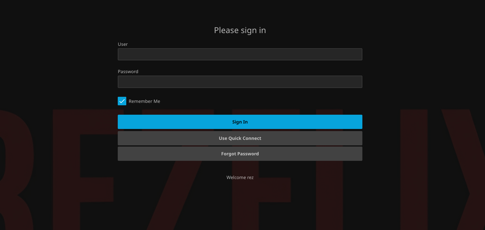
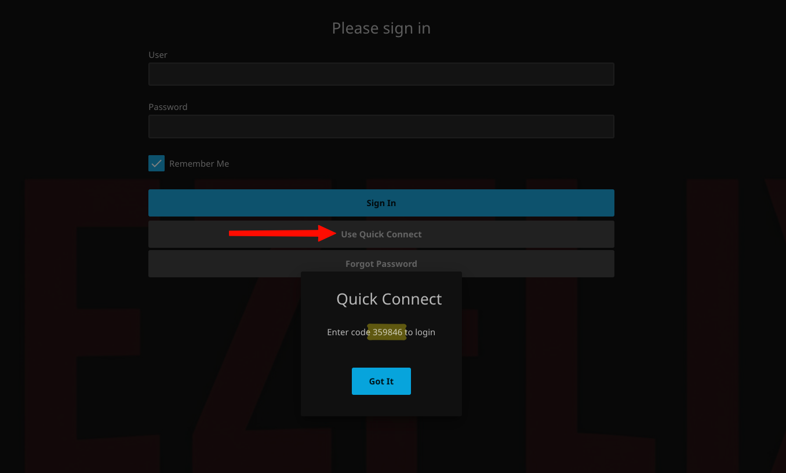

# Quick start

Everything you need to start watching, in one place. Each part links to a full guide when you
want more detail.

## How to use Rezflix

Rezflix works like other streaming services. You can watch in any web browser, or in an app on
your TV, phone, tablet, or streaming device.

!!! tip "We strongly recommend an app"

    Use an app on every device you watch on. Apps play more video and audio formats as they are,
    so you get the best picture and sound quality.

### Browser or app?

|                           | Browser                                      | App                                 |
| ------------------------- | -------------------------------------------- | ----------------------------------- |
| Picture quality           | Sometimes lowered so the browser can play it | Original quality on most devices    |
| 4K and HDR                | Limited, depends on browser and device       | Yes, on devices that support it     |
| Surround sound (5.1, 7.1) | Usually stereo only                          | Yes, with a surround speaker system |
| Dolby Atmos and DTS       | No                                           | On supported apps and devices       |
| Subtitles                 | Most formats                                 | All common formats                  |
| Best for                  | A quick watch on a computer                  | Everyday watching on any device     |

### Rezflix server address

Apps ask for a server address the first time you open them. Copy it from here.

```text title="Server address"
https://watch.rezflixtv.com
```

### Apps and settings

<div class="grid cards" markdown>

-   :material-cellphone-link:{ .lg .middle } **Apps**

    ---

    Find the right app for your TV, phone, computer, or streaming device, and set it up.

    [:octicons-arrow-right-24: Choose an app](apps/index.md)

-   :material-tune:{ .lg .middle } **Settings**

    ---

    Set video quality, subtitle and audio languages, your home screen, favorites, and playlists.

    [:octicons-arrow-right-24: Adjust your settings](settings.md)

</div>

## Sign in

1. Open [Rezflix Web](https://watch.rezflixtv.com){ target="_blank" rel="noopener" } or your app.
2. Enter your Rezflix username and password in **User** and **Password**.
3. Select **Sign In**.

{ loading=lazy }

### Sign in with Quick Connect

Quick Connect signs you in on a new device without typing your username and password. It is
handy on TVs, where typing with a remote is slow. You need to be signed in on another device
first, in the browser or in an app.

1. On the new device, select **Use Quick Connect** on the sign-in screen. A code appears.
2. On a device where you are already signed in, open your profile and select **Quick Connect**.
3. Enter the code and select **Authorize**.

The new device signs in by itself.

{ loading=lazy }

Cannot sign in? See [I cannot log in](troubleshooting.md#i-cannot-log-in).

## Request movies and shows

Something missing? With Rezflix Request you can ask for any movie or show you want to watch on
Rezflix, something most streaming services do not offer. We add your request as quickly as we
can.

Sign in to Rezflix Request with the same username and password you use for Rezflix.

<div class="rz-links" markdown="span">
[:material-plus-circle: Rezflix Request](https://request.rezflixtv.com){ .md-button target="_blank" rel="noopener" }
</div>

_[Video: web-03-request.mp4]_

!!! info "You get an email when it is ready"

    When your request is ready to watch on Rezflix, we send an email to the address you used when
    you registered for Rezflix.

[:octicons-arrow-right-24: How to request, step by step](requesting.md)

## Need more help?

- Something not working? Try [Troubleshooting](troubleshooting.md).
- Still stuck? [Contact us](contact.md).
